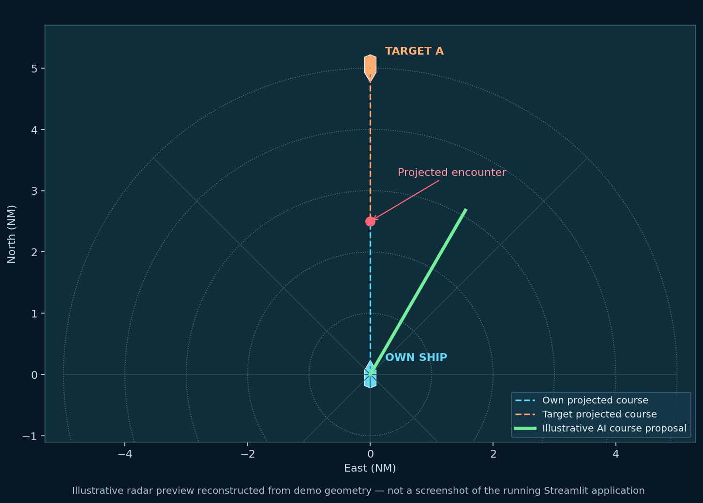

<div align="center">

# ⚓ MHATS
### Maritime Human–AI Teaming Simulator

**An interactive, human-in-the-loop maritime decision-support research prototype**

[](https://www.python.org/)
[](https://streamlit.io/)
[](https://plotly.com/python/)


*Visualize vessel encounters · Examine explainable recommendations · Record operator decisions*



<sub>Illustrative radar preview reconstructed from the simulation geometry—not a screenshot of the live Streamlit application.</sub>

</div>

> [!IMPORTANT]
> **Research and education only — NOT FOR NAVIGATION.** MHATS is not a certified navigation or collision-avoidance product. It does **not** implement validated COLREG compliance. Never use its outputs to make real-world vessel maneuvers.

---

## ✨ Why MHATS?

Maritime autonomy is not only about calculating a route. It also raises a human-factors question: **How should a maritime operator interact with an automated recommendation, understand its reasoning, and retain meaningful control?**

MHATS demonstrates this interaction in a small, reproducible synthetic environment. An operator can inspect a radar-style traffic picture, review a geometric course recommendation, and accept, reject, or modify it. The simulator records decisions for later exploratory analysis.

**Scope:** The current “AI” module is a **deterministic, geometry-based decision-support heuristic**, not a trained machine-learning model. MHATS illustrates *human–AI interaction design*, not demonstrated AI performance or maritime safety.

## 🧭 Contents

- [What you can explore](#-what-you-can-explore)
- [Radar guide](#-radar-guide)
- [Quick start](#-quick-start)
- [Try a complete scenario](#-try-a-complete-scenario)
- [How the prototype works](#-how-the-prototype-works)
- [Human–AI research ideas](#-humanai-research-ideas)
- [Project structure](#-project-structure)
- [Limitations and roadmap](#-limitations-and-roadmap)

## 🚢 What you can explore

| Capability | What it demonstrates |
|:--|:--|
| **Interactive radar** | Symbolic vessels, course projections, track history, range rings and closest-approach geometry |
| **Three encounter scenarios** | Synthetic crossing, head-on and overtaking situations |
| **CPA / TCPA estimates** | Relative-motion metrics under constant-velocity assumptions |
| **Explainable suggestion** | A candidate heading selected by a deterministic geometric search, with projected DCPA |
| **Human Only mode** | Operator decides without seeing the suggestion |
| **AI Only mode** | Operator can apply the automated candidate maneuver |
| **Human + AI mode** | Operator explicitly accepts, rejects or modifies a suggestion |
| **Decision logging** | Timestamp, scenario, mode, action, course change and pre-decision metrics; CSV download |

## 📡 Radar guide


| Color / symbol | Meaning |
|:--|:--|
| 🩵 **Cyan vessel** | Own ship and heading |
| 🟠 **Orange vessel** | Synthetic target vessel |
| **Cyan / orange dashed tracks** | Constant-course projections |
| 🟢 **Green course line** | Proposed geometric maneuver in AI-enabled modes |
| 🔴 **Red CPA indicator** | Predicted closest-approach geometry |
| **Concentric rings** | Relative range in nautical miles (NM) |

The radar uses **local East–North coordinates (NM)**, not a real chart, AIS feed or geographical map. Ship icons are symbolic and not to scale. In the running application, Plotly supports zoom and pan.

### Reading the dashboard

- **DCPA (NM):** estimated closest separation if current velocities remain constant.
- **TCPA (min):** estimated time until that closest approach.
- **Risk flag:** illustrative `HIGH` when DCPA < 0.5 NM **and** TCPA < 30 minutes; otherwise `LOW`. These are **demo thresholds**, not operational safety criteria.
- **Proposed heading:** a candidate maneuver evaluated using projected separation, **not** a verified COLREG recommendation.
- **Position uncertainty slider:** displayed for discussion only; it does **not** alter the risk calculation.
- **Advance simulation:** moves the synthetic vessels forward by the selected time step.

## 🚀 Quick start

**Requirements:** Python 3.10 or newer; an internet connection may be needed to install dependencies.

### 1. Get the code

Download this repository as a ZIP and extract it, **or** clone it after uploading to your GitHub account:

```bash
git clone https://github.com/YOUR_USERNAME/maritime-human-ai-teaming-simulator.git
cd maritime-human-ai-teaming-simulator
```

> Replace `YOUR_USERNAME` with your GitHub username. The URL above is a placeholder, not a live project link.

### 2. Create an environment (recommended)

**Windows PowerShell**

```powershell
python -m venv .venv
.venv\Scripts\Activate.ps1
```

**macOS / Linux**

```bash
python3 -m venv .venv
source .venv/bin/activate
```

### 3. Install and launch

```bash
python -m pip install -r requirements.txt
streamlit run app.py
```

Streamlit usually opens at **http://localhost:8501**. If it does not open automatically, copy the local URL printed in the terminal into your browser.

## 🎮 Try a complete scenario

1. In the sidebar, select **Head-on** and **Human + AI**.
2. Review the current **DCPA**, **TCPA**, risk flag and vessel positions.
3. Read the proposed heading alteration and the geometric rationale.
4. Click **Accept AI**, **Reject AI**, or choose a manual angle and click **Modify**.
5. Click **Advance simulation** to move the vessels; repeat to observe the updated encounter.
6. Open the **Experiment log** and export the CSV.
7. Select **Reset scenario**, switch to **Human Only**, and try the same starting situation without advice.

**Important behavior:** Decision buttons update the own-ship heading immediately but do not advance simulation time. The ship is modeled as changing heading instantaneously; there is no realistic turning-rate model.

## ⚙️ How the prototype works

```text
Synthetic encounter (own ship + one target)
                   |
                   v
          Relative-motion model
                   |
                   v
          CPA / TCPA estimation
                   |
                   v
      Candidate-heading evaluation
                   |
                   v
        Explanation + radar view
                   |
          +--------+--------+
          |        |        |
        Accept   Reject   Modify
          |        |        |
          +--------+--------+
                   |
                   v
       Update heading + log choice
                   |
                   v
          Advance simulation
```

### Closest point of approach

Let **r** be target position relative to own ship and **v** the target velocity relative to own ship. For nonzero relative speed, the time to closest point of approach is

$$
t_{CPA}=\max\left(0,-\frac{\mathbf r\cdot\mathbf v}{\mathbf v\cdot\mathbf v}\right)
$$

and the predicted closest separation is

$$
DCPA=\left\|\mathbf r+\mathbf v\,t_{CPA}\right\|.
$$

The implementation handles zero relative speed separately. Distances are shown in **nautical miles** and time in **minutes**. These are constant-velocity geometric estimates; they are not sufficient to establish a safe maneuver.

### What “explainable” means here

The dashboard displays a **human-readable geometric rationale**: candidate headings are compared by projected closest separation. It does not expose a learned model, estimate calibrated AI confidence, or prove compliance with navigation rules.

## 🧪 Human–AI research ideas

MHATS is a starting point for designing experiments—not evidence that human–AI teaming improves outcomes. Possible research questions include:

| Proposed comparison | Research question | What would be needed |
|:--|:--|:--|
| Human Only vs Human + AI | Does advice change response time or course choice? | Controlled participants and timing measures |
| Explanation vs no explanation | Does rationale affect appropriate reliance? | Multiple explanation conditions |
| Correct vs deliberately flawed advice | Can operators detect unreliable recommendations? | Validated scenarios and ethical safeguards |
| Low vs high workload | Does traffic complexity change override behavior? | Multi-target scenarios and workload measures |

The existing CSV records **actions**, not validated trust, workload, cognitive state, or navigation safety outcomes. Any human-subject claims require a suitable study design and, where applicable, ethics approval.

## 📁 Project structure

```text
maritime-human-ai-teaming-simulator/
├── app.py                     # Streamlit dashboard and simulation logic
├── requirements.txt           # Python dependencies
├── README.md                  # Documentation
├── .gitignore                 # Excluded local files
└── assets/
    └── radar_preview.png      # Illustrative radar image
```

### Add a real dashboard screenshot

The included radar image is a **generated illustration based on the model geometry**, not a verified capture of the app. After launching Streamlit, take a screenshot and save it as `assets/dashboard.png`. Then add the following Markdown near the top of this README:

```markdown

```

You can also record a short GIF of a complete decision cycle, provided you label it as a synthetic simulation.

## ⚠️ Limitations and roadmap

**Current limitations**

- Only one synthetic target vessel at a time.
- Point-mass motion; no ship turning dynamics, actuator constraints or hydrodynamics.
- No validated COLREG rule engine or safety assurance.
- No real AIS/radar data, geographic charts, wind, waves or sensor fusion.
- Uncertainty setting is illustrative and not propagated into the estimates.
- No trained machine-learning model or calibrated prediction confidence.
- No controlled human-subject experiments or evidence of improved safety.

**Planned extensions**

- [ ] Add automated tests for CPA/TCPA and scenario initialization.
- [ ] Add multiple vessels and configurable traffic density.
- [ ] Implement documented COLREG-oriented rules with explicit test cases.
- [ ] Introduce vessel turning dynamics and maneuver feasibility constraints.
- [ ] Model observation noise and uncertainty propagation.
- [ ] Compare explanation styles and operator override patterns.
- [ ] Design and ethically review a human-participant evaluation protocol.
- [ ] Publish real application screenshots and a short demonstration video.


</div>
